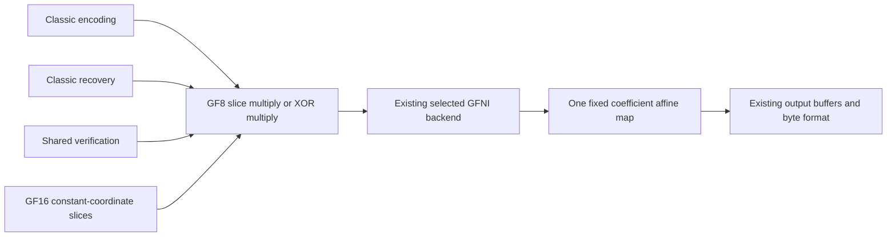

# GFNI direct affine multiplication review

Frozen runtime candidate: `193399ffc961d5c5df679ecc9a9db10b13191fe3`.
Comparator: unreleased main `a773e742e344a26413b8446480044daa68abd0bd`.
The pending GF16 norm PR #79 is a separate candidate and is not included here.

## One common arithmetic path

The previous GFNI slice loops transform bytes from the 0x11d field to the
AES field, multiply, then transform back. For a fixed coefficient `c`, the complete
function is linear over GF(2). Its eight basis outputs already exist in
`MUL_TABLE[c][1 << bit]`. Transposing those bits constructs its complete 8x8 map.
A 256-entry / 2 KiB read-only table is derived at compile time from the existing
field table, with no second polynomial definition or runtime initialization.

One [GFNI affine operation](https://doc.rust-lang.org/core/arch/x86_64/fn._mm256_gf2p8affine_epi64_epi8.html)
then computes the product directly in the original field. The source hot loop
changes from two affine transforms plus one field product to one affine transform.
This is an arithmetic-work reduction, not a claim of threefold throughput.
A separate static x86 compilation checks all four kernel specializations: the
baseline contains both affine and field-multiply instructions, while every new
specialization retains affine instructions and has no field-multiply instruction.
Compilation is not hardware timing.
Both 256-bit and 512-bit overwrite/XOR paths retain their load/store boundaries,
zero/one shortcuts, length assertions and scalar tails.

Backend priority, explicit overrides, shape selection, parallel thresholds,
scratch lifetimes, payload allocation and public APIs are unchanged. No new
production unsafe block or heap allocation is introduced. Generic fallible
reconstruction, late errors, selective recovery, normal format identities and
Leopard dispatch retain their existing implementations. Other backends do not
read this table; non-x86 production builds do not include it.

## Executed correctness

The portable matrix oracle checks all 65,536 coefficient/input products against
the existing scalar multiplication table, including zero and identity. Native
Linux positively executes both GFNI widths for 256 coefficients, 20 lengths,
three input/output offset pairs and both overwrite/XOR operations: 61,440 slice
configurations, with boundary sentinels. This includes 31/32/33 and 63/64/65 byte
boundaries, all byte inputs and larger tails. Both execution markers are required;
a green hardware-skipped test is not treated as positive ISA execution.

The frozen candidate passes 537 all-feature codec tests (371 library / 166
integration; 43 existing ignored), 244 codec-only no_std tests, strict all-target
codec Clippy, x86_64 Linux library Clippy and formatting. ARM64 executes the
portable field oracle; its compilation does not claim GFNI execution. The
isolated Linux candidate additionally passes all seven direct GFNI unit tests,
the matrix oracle, seven encoding-dispatch regressions and the actual published
9.0.0 200-configuration exact-parity/bidirectional recovery probe.

The [source-bound functional record](../benchmarks/release-9.1.0/2026-10-24/gfni-direct-affine-functional-review.json)
keeps local, native-Linux and static-assembly checks separate from performance
acceptance.

## Separate complete diagnostic context

The [completed combined Linux diagnostic](complete-linux-diagnostic-2026-10-24.md)
keeps all 20,724 observations and refusals for frozen `9f935ee` versus published
9.0.0. An independent frozen replay exactly reproduces its entire report. The
GFNI leaf source in that candidate is byte-identical to the present comparator's
leaf source, but other production/tool files differ. This is not whole-source
or timing/allocation-geometry equivalence. Neither those old observations nor
ordinary CI approve the new kernel or explain all earlier regressions.

## Frozen component comparison

A new independent Linux component plan has launched once, with 73 fixed cases:
the complete 27-case GF8/GF16 constructor/cold/warm/encoding/general-tower catalog,
36 direct-kernel cases across both explicit GFNI widths, and ten explicit scalar
controls. Its 292 fixed-count component workers retain three warmups and nine samples
(3,504 observations), phase-major A1/B1/B2/A2. Each role doubles pilot counts to
200 ms and shares the larger count. The limits remain 10% central width, 5%
repeat, 100 ms minimum measurement and 12% cross-version regression across all
four pairings. Every statistical refusal is retained before analysis.

Both sources and lockfiles are frozen independently. All 73 deterministic input /
expected-output byte witnesses match between roles; this does not assert matching
dynamic buffers or physical memory. Construction prepares the original eight-CPU
budget before only the calling thread is pinned. Timing uses std + simd-accel
with metrics disabled. Forced backend names must match. Batch wall/thread-CPU
windows are distinct from exclusive API cycles; page faults are not measured by
this component harness. The older frozen tool is used only for the zero-codec
resource/process-ownership preflight, not as the timed sampler or candidate.

The complete result is still pending. Frozen source, driver, guard, cases and
counts are not changed after launch. This distinct component schema has
`formal_performance_geometry_equivalence=false` and `release_approval=false`;
it cannot replace complete accepted final-source Linux evidence or strict positive
release preflight. No tag or registry upload is performed.
