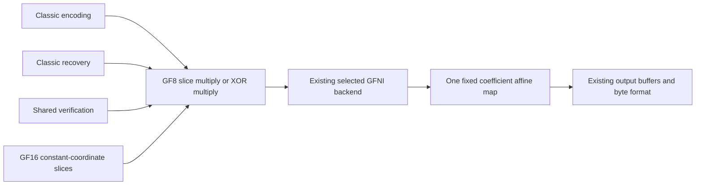

# GFNI direct affine multiplication review

Frozen runtime candidate: `193399ffc961d5c5df679ecc9a9db10b13191fe3`.
Comparator: unreleased main `a773e742e344a26413b8446480044daa68abd0bd`.
The pending GF16 norm PR #79 is a separate candidate and is not included here.

## One common arithmetic path

The previous GFNI slice loops transform bytes from the 0x11d field to the
AES field, multiply, then transform back. For a fixed coefficient `c`, the complete
function is linear over GF(2). Its eight basis outputs already exist in
`MUL_TABLE[c][1 << bit]`. Transposing those bits constructs its complete 8x8 map.
A 256-entry / 2 KiB read-only table is derived at compile time from the existing
field table, with no second polynomial definition or runtime initialization.

One [GFNI affine operation](https://doc.rust-lang.org/core/arch/x86_64/fn._mm256_gf2p8affine_epi64_epi8.html)
then computes the product directly in the original field. The source hot loop
changes from two affine transforms plus one field product to one affine transform.
This is an arithmetic-work reduction, not a claim of threefold throughput.
A separate static x86 compilation checks all four kernel specializations: the
baseline contains both affine and field-multiply instructions, while every new
specialization retains affine instructions and has no field-multiply instruction.
Compilation is not hardware timing.
Both 256-bit and 512-bit overwrite/XOR paths retain their load/store boundaries,
zero/one shortcuts, length assertions and scalar tails.

Backend priority, explicit overrides, shape selection, parallel thresholds,
scratch lifetimes, payload allocation and public APIs are unchanged. No new
production unsafe block or heap allocation is introduced. Generic fallible
reconstruction, late errors, selective recovery, normal format identities and
Leopard dispatch retain their existing implementations. Other backends do not
read this table; non-x86 production builds do not include it.

## Executed correctness

The portable matrix oracle checks all 65,536 coefficient/input products against
the existing scalar multiplication table, including zero and identity. Native
Linux positively executes both GFNI widths for 256 coefficients, 20 lengths,
three input/output offset pairs and both overwrite/XOR operations: 61,440 slice
configurations, with boundary sentinels. This includes 31/32/33 and 63/64/65 byte
boundaries, all byte inputs and larger tails. Both execution markers are required;
a green hardware-skipped test is not treated as positive ISA execution.

The frozen candidate passes 537 all-feature codec tests (371 library / 166
integration; 43 existing ignored), 244 codec-only no_std tests, strict all-target
codec Clippy, x86_64 Linux library Clippy and formatting. ARM64 executes the
portable field oracle; its compilation does not claim GFNI execution. The
isolated Linux candidate additionally passes all seven direct GFNI unit tests,
the matrix oracle, seven encoding-dispatch regressions and the actual published
9.0.0 200-configuration exact-parity/bidirectional recovery probe.

The [source-bound functional record](../benchmarks/release-9.1.0/2026-10-24/gfni-direct-affine-functional-review.json)
keeps local, native-Linux and static-assembly checks separate from performance
acceptance.

## Separate complete diagnostic context

The [completed combined Linux diagnostic](complete-linux-diagnostic-2026-10-24.md)
keeps all 20,724 observations and refusals for frozen `9f935ee` versus published
9.0.0. An independent frozen replay exactly reproduces its entire report. The
GFNI leaf source in that candidate is byte-identical to the present comparator's
leaf source, but other production/tool files differ. This is not whole-source
or timing/allocation-geometry equivalence. Neither those old observations nor
ordinary CI approve the new kernel or explain all earlier regressions.

## Frozen component comparison

A new independent Linux component plan has launched once, with 73 fixed cases:
the complete 27-case GF8/GF16 constructor/cold/warm/encoding/general-tower catalog,
36 direct-kernel cases across both explicit GFNI widths, and ten explicit scalar
controls. Its 292 fixed-count component workers retain three warmups and nine samples
(3,504 observations), phase-major A1/B1/B2/A2. Each role doubles pilot counts to
200 ms and shares the larger count. The limits remain 10% central width, 5%
repeat, 100 ms minimum measurement and 12% cross-version regression across all
four pairings. Every statistical refusal is retained before analysis.

Both sources and lockfiles are frozen independently. All 73 deterministic input /
expected-output byte witnesses match between roles; this does not assert matching
dynamic buffers or physical memory. Existing-codec cases prepare the codec/pool before the calling thread is pinned.
Constructor cases prewarm one instance before pinning, then create fresh objects
inside the pinned measurement loop. Those new instances can resolve policy under
the pinned affinity; constructor geometry is not equated with the formal sampler's
construction-before-pin contract. Timing uses std + simd-accel
with metrics disabled. Forced backend names must match. Batch wall/thread-CPU
windows are distinct from exclusive API cycles; page faults are not measured by
this component harness. The older frozen tool is used only for the zero-codec
resource/process-ownership preflight, not as the timed sampler or candidate.

## Completed capture, retained source-check failure

All 292 ABBA workers / 3,504 observations finished. The original controller then
failed its final source-clean assertion: it had compiled its own executable into
each source checkout, where that file was untracked. The original failure,
controller, samples and raw journals remain unchanged. A later read-only audit
finds matching commit/tree/lock identities, no tracked changes and only those
owned executables untracked; this is a post-capture observation, not a retroactive
passing source check. Future controller output belongs in the already ignored
build directory, retaining the original strict source check. No new timing run
is launched for that output-path correction.

An independent saved-data reader validates every original worker exit, backend,
payload witness, count, pilot history and numeric summary against its raw output.
It reads all 3,673 journalled workers: 146 functional, 3,235 calibration and 292
ABBA workers, with zero worker exit failures. Its statistics exactly reproduce
the frozen controller's original pure-analysis block. No observation, count,
warmup or threshold is changed. The [complete numerical review](../benchmarks/release-9.1.0/2026-10-24/gfni-direct-affine-component-review.json)
contains all 73 cases and every warmup/measured wall and thread-CPU value, including
all four cross-version comparisons. Host details, full addresses, executable
fingerprints and absolute clock endpoints remain private.

The result still fails the existing component limits: **one distribution,
11 same-version repeats and one cross-version regression observation**, with zero
short measured samples. That last observation is not an accepted regression
attribution because the complete comparison is unqualified.

Distribution failure: `auto|gf8:cold:32:16:4096:1`, B1, **11.820607%**.
Complete repeat failures:

| Case | Pair | Drift |
| --- | --- | ---: |
| `auto\|gf8:encode:10:4:1024:0` | A1/A2 | 7.817765% |
| `auto\|gf16:warm:10:4:1024:1` | A1/A2 | 5.652419% |
| `auto\|gf16:multiply_tower:0:0:1024:0` | B1/B2 | 5.101128% |
| `auto\|gf16:accumulate_tower:0:0:1024:0` | B1/B2 | 7.193051% |
| `rust-gfni-avx2\|gf8:accumulate:0:0:63:0` | A1/A2 | 13.569879% |
| `rust-gfni-avx2\|gf8:accumulate:0:0:65536:0` | B1/B2 | 6.249915% |
| `rust-gfni-avx512\|gf8:multiply:0:0:33:0` | B1/B2 | 5.936964% |
| `rust-gfni-avx512\|gf8:multiply:0:0:1024:0` | B1/B2 | 5.202534% |
| `rust-gfni-avx512\|gf8:accumulate:0:0:1024:0` | A1/A2 | 18.809208% |
| `rust-gfni-avx512\|gf8:accumulate:0:0:1024:0` | B1/B2 | 8.203080% |
| `rust-gfni-avx512\|gf8:accumulate:0:0:65536:0` | A1/A2 | 5.786212% |

The threshold observation is `auto|gf16:warm:10:4:1024:1`: all four candidate /
baseline wall ratios span **1.075739–1.139110**. Its baseline repeat also fails
at 5.652419%. Unchanged scalar multiplication at 1 KiB instead spans
0.811488–0.821498. Those source-level unchanged controls caution against
assigning a favorable movement to GFNI; code placement, compilation context and
execution-service differences remain possible explanations. These data do not
uniquely attribute the residual to the VM, and the harness does not measure faults
or exclusive codec CPU. No PMU or fixed-frequency release condition is added.

The two owned partitions are gone, the original controllers and all 11 parent
masks match the before snapshot, and there were no background-load holders or
outside-workload rows in the 1,591 guard observations. Source and cleanup checks
were read independently after termination. The original controller's `failed`
status remains retained. Resources restored and complete data recovered do not
mean performance accepted.

A second independent read checks all raw logs/JSON, both backend names, payload
witnesses, every pilot count, all 7,346 parent events and every wall/thread-CPU
median against the published recovery. All 3,673 workers and 3,504 warmup/measured
observations agree; the original failed terminal status and every input remain
unchanged. It executes no codec workload. This audit separately records one
controller completion error and zero worker execution errors, rather than turning
the source-clean failure into a statistical refusal.

PR #82's Darwin cancellation fix is now integrated through main `afb9a52`.
The rebased GFNI codec source files match the frozen candidate byte for byte;
this does not relabel its old source/lock/capture binding as a new final candidate.
`accepted_component_comparison=false`, `candidate_attribution=null` and
`release_approval=false` remain explicit. Keep the candidate draft while its
performance remains unaccepted. No unchanged matrix is rerun, no tag or registry
upload is performed, and final-source complete Linux/layout evidence plus actual
strict positive preflight remain outstanding.

## Caller ownership follow-through

The [complete owner/residency review](recovery-ownership-review-2026-10-24.md)
independently replays all 348 historical structural workers and retains every
case and counterexample. In its 10+4/64 KiB data-only case, the 192-fault
increment is bounded before decoder entry, between retained and cloned caller
views. Other larger-shard conditions have nonzero recovery intervals on both
versions. Those source-copy conditions cannot uniquely attribute the original
formal timing gap or qualify this GFNI candidate. A new GF8/GF16 regression
verifies zero warmed allocation requests for existing owned-buffer encode,
recovery and verification workflows; it changes no production allocation policy.
