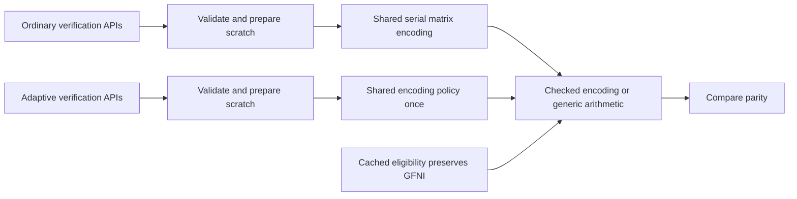

# 9.1.0 merged-candidate review

Review date: 2026-10-23 (Asia/Shanghai). The combined implementation is on main `bfff0fc`;
performance acceptance and publication remain incomplete.

## Exact source and review scope

| Source | Identity | Meaning |
| --- | --- | --- |
| Frozen runtime candidate | `449920e428cee723e27f9280f62f917e08f784e0` | Candidate used by the prepared Linux comparison |
| Original checked PR head | `09597e43aae2c5d454683f056a72e7bd295371b9` | Completed ordinary CI and package dry-run |
| Rebased PR head | `51bdd8cd0dc4356304639d528ae554d4d152531d` | External rebase of PR #57 |
| Prior merged main | `14cf56e0d4381451af12e3c163677d811729d13a` | PR #57 merged externally |
| Frozen combined Linux source | `9f935eef9c1af721165b245709897f7c4b9acc37` | Includes PR #58; current complete Linux diagnostic candidate |
| Current main with native models | `bfff0fcf187b99109927ec1de824b0977f2b4e6e` | Also includes merged PR #61; a different complete tool/file tree |

The first four historical identities have the same complete Git file tree.
Relative to `449920e`, frozen combined `9f935ee` additionally changes
`src/core/encode.rs`, `src/core/verify.rs`, related tests and the verification
observer adapter. Current main `bfff0fc` also includes the native model migration.
Its codec sources match `9f935ee`, but its complete tool/file tree differs.
Neither complete source is identical to frozen `449920e`. Manifests, lockfile, build script and
Cargo configuration remain unchanged, but that does not establish timing or
allocation-lifetime equivalence. Measurements retain their original commit
labels; the final combined source requires its own freeze and accepted evidence.

The review followed ordinary and adaptive verification through their callers,
public count/length validation, shared matrix encoding, backend initialization
and eligibility, checked kernel execution, and regression tests. Every current
caller validates nonempty Classic inputs before entering the private serial
helper. Family and fast-parity dispatch remain at the public boundary. No
additional supported runtime defect was found in this scope.

## Shared execution design

Ordinary verification, caller-buffer verification and workspace verification
share `check_classic_parity` and the serial `encode_classic_matrix` implementation
with ordinary encoding. The two duplicate parity-check implementations are
removed. Serial APIs retain their existing generic bounds; this refactor does
not require their callers to become `Send` or `Sync`.

Adaptive verification reaches the existing encoding policy once. Both execution
routes use the shared checked encoding boundary. Backend eligibility is cached: an automatically selected GFNI backend keeps its priority
over generated table-based AVX2 encoding. Explicit overrides, other backends,
Leopard handling, scratch ownership and encoded bytes retain their contracts.
The change adds no shape-specific exception, size threshold or allocator tuning.

Generated kernels still validate every coefficient row and shard before writing.
Preparation failures use the existing generic path; execution errors propagate
without selecting another algorithm after parity has been modified. Generic
reconstruction's publication, late-failure and selective-output behavior remains
outside this patch's changes.

## Completed functional checks

The frozen candidate passed 356 codec unit tests (five existing ignored tests),
92 tests across eleven integration programs, 129 native-tool tests and all 273
Python controller tests. Strict codec/tool Clippy, codec-only no_std, formatting,
spelling and diff checks passed. The GFNI-priority behavior regression failed with
the previous eligibility rule and passed with the fix.

Ordinary CI on `09597e4` completed 31 successful checks. The
[release-tooling job](https://github.com/houseme/rustfs-erasure-codec/actions/runs/39887761249/job/120200102869)
passed the native/controller checks and the actual distributable dry-run. Its
archive contains 67 core package files; upload was aborted because this was a
dry-run. This is completed validation on the recorded source, not a claim that
every later main commit or CI run has independently passed.

The same source's `Validate controlled release evidence`, `Release preflight`
and `Publish to crates.io` checks were skipped. None supplies positive release
acceptance or publication. A merged PR and green ordinary CI do not check those
boxes.

## Validation of the combined implementation

The merged `9f935ee` implementation passed 356 codec unit tests (five existing
ignored tests), 93 tests across the same eleven integration programs, 129
native-tool tests and all 273 Python controller tests. Strict codec/tool Clippy,
codec-only no_std, formatting and diff checks passed. These are new-source checks;
they do not relabel the frozen candidate's results above. New main CI remains
bound to its own actual run status.

The expanded dispatch tests exercise all three ordinary verification entries,
corruption detection, caller scratch contents, safe-Field view fallback and the
single preparation contract. The observer adapter recognizes both old and new
verification return forms; it does not rewrite the frozen sampler or approve
instrumented geometry as formal performance evidence.

## Repository-tool integration

Source `709c40b` additionally integrates the native diagnostic consolidation with
main `e3aca32`. Its implementation corresponds to published review head
`c176ac2`; their full Git file difference contains only three documentation files.
Executed validation labels remain `709c40b`. Main `bfff0fc` has the same complete
Git file tree as `c176ac2`; no measurement label is changed. Codec sources, manifests, lockfile, build configuration and WASM
match main; the tool implementation changes. The new tree passes 194 native tests,
247 Python controller tests, strict tooling Clippy and Linux x86_64 metadata
compilation. All 167 legacy/native comparisons and both complete baseline request
witnesses are recorded in the [current global review](global-review-9.1.0-2026-10-23.md#current-main-integration-and-complete-native-diagnostic-boundary).
These results describe repository tools and do not rebind codec measurements.

The complete combined-source Linux diagnosis is running separately at frozen
`9f935ee` versus published 9.0.0, including both calibrations, all 126 original
ABBA cases and all paired layouts. Its Linux functional/input checks passed;
full collection and frozen independent replay remain pending. New tool code is
not deployed into that owned campaign, and its diagnostic-only schema cannot
supply automatic release approval.

## Retained performance results and next execution

The [complete verification review](verify-dispatch-review-2026-10-23.md) preserves
the original 28-worker comparison, its +15.0854% stream-verification threshold
failure, and the later complete backend control. Within each backend condition,
caller fixtures match; between conditions, stream fixtures differ. The control
supports the shared-backend candidate without proving a unique ISA cause or
explaining all historical Linux drift.

The new comparison is frozen at candidate `449920e` versus main `340fc19`:
all eleven original small-file encode cases and all five original stream verify
cases, complete A1/B1/B2/A2, 64 workers and 768 observations. Original common
iteration counts and three warmups/nine samples are retained. All 32 repeats,
64 comparisons and eight scoped regression programs are evaluated after the
planned collection; statistical failure does not truncate it. The frozen plan
has completed and independently replays exactly. All 64 distributions and eight
regression programs pass, with no short sample; three of 32 repeats exceed 5%
(maximum 8.3833%). Sources, resources and observer services are restored. The
[complete GFNI review](gfni-priority-review-2026-10-23.md) preserves every case,
pairing and failure. The affected catalog is not accepted performance evidence.

This affected catalog compares two earlier unreleased sources. It does not
include the later shared Classic helper and cannot be promoted to timing evidence
for combined main `9f935ee`, even if every scoped check passes. It also cannot
replace the complete published-9.0.0 baseline/final-candidate comparison or paired
layouts.
The [publication blockers](release-9.1.0-blockers.md) and
[release checklist](release-9.1.0-checklist.md) remain authoritative: freeze the
final source/lock/harness, obtain accepted complete baseline/ABBA/layout evidence,
bind its immutable evidence commit and run the actual strict positive preflight.
No tag or registry upload is authorized by this review.
