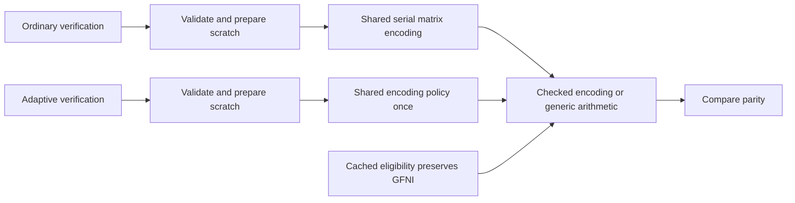

# 9.1.0 merged-candidate review

Review date: 2026-10-23 (Asia/Shanghai). Reviewed main snapshot:
`62632e5419b13b65973c51033718be00b14d2442`. Functional and preparation checks
pass in their recorded scope; performance acceptance and publication remain incomplete.

## Exact sources and evidence

| Source | Identity | Recorded scope |
| --- | --- | --- |
| Earlier runtime candidate | `449920e428cee723e27f9280f62f917e08f784e0` | Completed 64-worker affected catalog |
| Original checked PR head | `09597e43aae2c5d454683f056a72e7bd295371b9` | Earlier ordinary CI and package dry-run |
| Rebased PR head | `51bdd8cd0dc4356304639d528ae554d4d152531d` | External rebase of PR #57 |
| Earlier merged main | `14cf56e0d4381451af12e3c163677d811729d13a` | PR #57 merged externally |
| Frozen full Linux source | `9f935eef9c1af721165b245709897f7c4b9acc37` | Running complete diagnostic versus published 9.0.0 |
| Earlier native-model main | `bfff0fcf187b99109927ec1de824b0977f2b4e6e` | Merged PR #61; historical source correspondence retained |
| Reviewed main snapshot | `62632e5419b13b65973c51033718be00b14d2442` | Includes empty-shard alignment, native source plans and Darwin group cleanup |

The first four identities have the same complete Git file tree. That historical
relation does not extend to the later rows. Relative to frozen `9f935ee`, reviewed
main changes the empty `AlignedShard` representation and related tests, plus
repository tools and documentation. Manifests, lockfile, build script and Cargo
configuration remain unchanged. Similar codec paths or unchanged dependencies do
not establish complete source-tree, timing or allocation-lifetime equivalence.
All measurements retain their actual source identities.

The review followed ordinary/adaptive verification, validation macros, checked
kernel preparation/execution, cached backend eligibility, aligned storage,
observer-plan construction, source ownership and complete process-group cleanup.
No additional supported defect requiring another runtime branch was found in
this scope. The changes below repair contracts at shared ownership boundaries.

## Shared execution and ownership

Ordinary verification, caller-buffer verification and workspace verification
share `check_classic_parity` and serial `encode_classic_matrix` with ordinary
encoding. Serial APIs retain their original generic bounds. Adaptive verification
reaches the existing encoding policy once. Both routes use the checked encoding
boundary; cached eligibility preserves automatic GFNI priority over generated
table-based AVX2 encoding. Explicit overrides, other backends, Leopard and fast
parity dispatch, public count/length checks and scratch ownership retain their
contracts. Preparation completes before writes; execution errors propagate.
Generic reconstruction keeps decode-before-publication, late failure and
selective-output behavior.

Empty aligned storage now uses a private 64-byte-aligned zero-sized type for its
dangling pointer. A compile-time assertion binds that representation to
`SHARD_ALIGNMENT`. Empty construction remains allocation-free; nonempty allocation,
deallocation, the public struct and encoded bytes are unchanged. This corrects
the documented pointer-alignment contract, without explaining service-time drift.

Observer installation prepares generated files and their bindings in one native
plan. Verify, stream-core and dynamic observers use the same source-overlay
owner; independent committed-source checks retain their separate provenance
purpose. The helper's build output stays under its own source root even when
`CARGO_TARGET_DIR` is inherited. These changes reduce duplicate preparation and
preserve tool identity; they are not codec throughput measurements.

The process owner keeps its leader unreaped while stopping the group it created.
On Darwin's EPERM path, two complete native membership snapshots must confirm
that all remaining members are already exited, with matching PID/start identity.
Live, unknown or incomplete groups retain the original error. Cleanup does not
reinterpret a permission error as successful cancellation. The scope remains
owned process groups, without a claim about arbitrary detached sessions or
Windows job trees.

## Validation on the reviewed snapshot

All checks below ran on `62632e5`; inputs remained unchanged during validation.
Later documentation commits do not relabel that executed source.

| Check | Actual outcome |
| --- | --- |
| Optimized native tools | 199 passed: 171 unit and 28 CLI |
| Codec all-feature library | 357 passed; five existing ignored |
| Codec-only no_std library | 237 passed |
| Complete Python controllers | 248 passed |
| Strict codec/tool Clippy, all targets | Passed |
| Linux x86_64 tool all-target metadata compilation | Passed; compilation evidence only |
| Formatting | Passed |
| Core 9.1.0 manifest/tag consistency | Passed; metadata check only |
| Workspace dependency inheritance | All five members pass |
| JSON audit | Passed; historical evidence retained |
| Actual core/WASM package lists | 67/6 members; tooling and evidence excluded |

Native regressions positively exercise Darwin groups with 1, 2, 5 and 33 exited
members, reject an exited leader hiding a live member, and refuse unknown groups.
Source-plan regressions retain complete generated bytes and hashes, refuse
changed anchors and unknown variants, and restore owned inputs. Python bindings
check one plan per installation and explicit source-local helper build output.
The empty-shard regression covers batch construction, cloning, slices, iterators
and both pointer views. These checks do not establish hardware-counter fidelity,
physical-host isolation or performance acceptance.

Earlier independent checks remain bound to their own sources: `709c40b` passed
194 native and 247 Python tests, 51 baseline comparisons and 116 complete
calibration/campaign comparisons. Its implementation correspondence with
published `c176ac2` and main `bfff0fc` remains explicit. The
[complete tooling report](../benchmarks/tooling/2026-10-23/native-diagnostic-consolidation.json)
retains all outcomes and the two declared stronger original-file refusals.
The fixed baseline fixture's 68 requests / 15,257,891 bytes versus one / 289
measures IPC and request volume only. Those results are not new codec timing,
RSS or Linux-drift evidence for `62632e5`.

## Retained timing results and running complete capture

The [earlier verification review](verify-dispatch-review-2026-10-23.md) retains
all 28 workers and the +15.0854% stream-verification refusal on `17432e5`.
The later backend control keeps all results and its differing cross-condition
stream fixtures; it does not prove an ISA-only cause or erase the first failure.

The [complete GFNI review](gfni-priority-review-2026-10-23.md) retains candidate
`449920e` versus `340fc19`: all 64 workers / 768 observations, sixteen cases,
32 repeats, 64 comparisons and eight programs independently replay exactly.
Distributions and scoped regression programs pass, but three repeats exceed 5%
(maximum 8.3833%). The complete affected catalog is not accepted evidence.

The running full Linux campaign remains frozen at `9f935ee` versus published
9.0.0. Both calibrations have completed; original A1/B1/B2/A2 profiles and all
paired layouts continue before final analysis. Statistical failures do not
truncate collection. New main code, source plans and cleanup changes are not
deployed into that reservation. Full collection, source/resource restoration and
independent replay with its own frozen tool remain pending. Partial successful
workers and ordinary CI do not qualify the campaign or later main snapshots.
The [earlier complete diagnostic](complete-linux-diagnostic-2026-10-22.md) and
all its refusals retain their original source and acceptance status.

## Concrete remaining release work

1. Finish the current complete diagnostic, independently replay every original
   record and analyze all failures and counterexamples. Preserve its diagnostic-only
   schema and original limits; do not turn it into formal evidence by relabeling.
2. Freeze the final candidate tree, lockfile and harness after the intended
   changes are integrated. Store evidence on its separate immutable evidence
   commit. Later candidate-tree changes require their own binding; documentation
   or tool changes do not silently inherit a prior complete-tree acceptance.
3. Obtain accepted complete published-baseline, ABBA and paired-layout evidence
   with the original duration, 5% repeat, 10% distribution and regression checks.
   A recorded source/condition change must justify another campaign; do not
   repeat unchanged failures until a favorable result appears.
4. Configure the accepted full evidence commit and run the actual strict positive
   release preflight on its bound candidate. At this review,
   `RSE_RELEASE_EVIDENCE_REF` is not configured. Ordinary CI's skipped evidence,
   preflight and publication jobs do not supply positive acceptance.

The core manifests already declare 9.1.0 and the changelog remains unreleased.
Manifest/tag consistency does not create a tag or publish a package. Fixed
frequency, PMU access and a unique cause for every historical refusal are
investigation options, not added release gates. The
[publication blockers](release-9.1.0-blockers.md) and
[release checklist](release-9.1.0-checklist.md) retain the complete acceptance
requirements. No tag or registry upload was performed.
