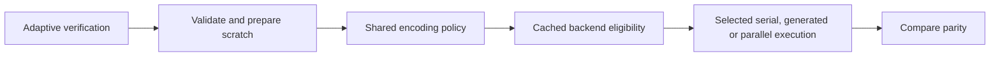

# 9.1.0 merged-candidate review

Review date: 2026-10-23 (Asia/Shanghai). The implementation is on main;
performance acceptance and publication remain incomplete.

## Exact source and review scope

| Source | Identity | Meaning |
| --- | --- | --- |
| Frozen runtime candidate | `449920e428cee723e27f9280f62f917e08f784e0` | Candidate used by the prepared Linux comparison |
| Original checked PR head | `09597e43aae2c5d454683f056a72e7bd295371b9` | Completed ordinary CI and package dry-run |
| Rebased PR head | `51bdd8cd0dc4356304639d528ae554d4d152531d` | External rebase of PR #57 |
| Merged main | `14cf56e0d4381451af12e3c163677d811729d13a` | PR #57 merged externally |

All four identities have the same complete Git file tree. Measurements retain
their original commit labels; file equality does not rewrite their provenance or
make a diagnostic report accepted release evidence. Any later source change
requires a new review and final-source freeze.

The review followed the changed adaptive verification methods through core
verification and encoding, backend initialization and eligibility, checked kernel
execution, and their regression tests. No additional supported runtime defect was
found in this scope. Preserve the existing validation and ownership boundaries
while the prepared comparison tests the resulting performance.

## Shared execution design

Adaptive verification now reaches the existing encoding policy once. Backend
eligibility is cached: an automatically selected GFNI backend keeps its priority
over generated table-based AVX2 encoding. Explicit overrides, other backends,
Leopard handling, scratch ownership and encoded bytes retain their contracts.
The change adds no shape-specific exception, size threshold or allocator tuning.

Generated kernels still validate every coefficient row and shard before writing.
Preparation failures use the existing generic path; execution errors propagate
without selecting another algorithm after parity has been modified. Generic
reconstruction's publication, late-failure and selective-output behavior remains
outside this patch's changes.

## Completed functional checks

The frozen candidate passed 356 codec unit tests (five existing ignored tests),
92 tests across eleven integration programs, 129 native-tool tests and all 273
Python controller tests. Strict codec/tool Clippy, codec-only no_std, formatting,
spelling and diff checks passed. The GFNI-priority behavior regression failed with
the previous eligibility rule and passed with the fix.

Ordinary CI on `09597e4` completed 31 successful checks. The
[release-tooling job](https://github.com/houseme/rustfs-erasure-codec/actions/runs/39887761249/job/120200102869)
passed the native/controller checks and the actual distributable dry-run. Its
archive contains 67 core package files; upload was aborted because this was a
dry-run. This is completed validation on the recorded source, not a claim that
every later main commit or CI run has independently passed.

The same source's `Validate controlled release evidence`, `Release preflight`
and `Publish to crates.io` checks were skipped. None supplies positive release
acceptance or publication. A merged PR and green ordinary CI do not check those
boxes.

## Retained performance results and next execution

The [complete verification review](verify-dispatch-review-2026-10-23.md) preserves
the original 28-worker comparison, its +15.0854% stream-verification threshold
failure, and the later complete backend control. Within each backend condition,
caller fixtures match; between conditions, stream fixtures differ. The control
supports the shared-backend candidate without proving a unique ISA cause or
explaining all historical Linux drift.

The new comparison is frozen at candidate `449920e` versus main `340fc19`:
all eleven original small-file encode cases and all five original stream verify
cases, complete A1/B1/B2/A2, 64 workers and 768 observations. Original common
iteration counts and three warmups/nine samples are retained. All 32 repeats,
64 comparisons and eight scoped regression programs are evaluated after the
planned collection; statistical failure does not truncate it. The frozen plan
has now been launched after the previous controlled capture completed and restored
its resource and observer services. Complete collection and independent replay
are pending; launching the guard does not establish a performance result.

This affected catalog compares two unreleased sources. It cannot replace the
complete published-9.0.0 baseline/final-candidate comparison or paired layouts.
The [publication blockers](release-9.1.0-blockers.md) and
[release checklist](release-9.1.0-checklist.md) remain authoritative: freeze the
final source/lock/harness, obtain accepted complete baseline/ABBA/layout evidence,
bind its immutable evidence commit and run the actual strict positive preflight.
No tag or registry upload is authorized by this review.
