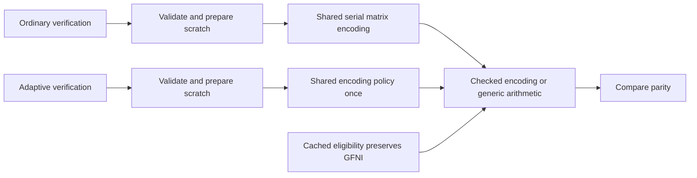

# 9.1.0 merged-candidate review

Independent combined-source rehearsal (2026-10-25): review commit `6193ad3`
combines PR #107 `0dd9434` and PR #106 `4fdb83a`, retaining both source histories.
The [complete review](combined-coding-local-review-2026-10-25.md) records 578 parent
codec tests / 271 no_std / 317 tool tests, all 459 unchanged resource contracts,
published-9.0.0 and fresh WASM compatibility, plus an actual 71-member crate whose
68 source members match exactly and whose extracted library passes 401/271 tests.
All 31 original inputs replay unchanged without codec work. This independent
review source has no combined CI or controlled timing acceptance; actual main
integration, final source binding and strict positive preflight remain required.

Parent-source records below retain their independent validation bindings. This
review-branch combination has no performance or release approval.

Windows parity-row validation (2026-10-25): test/workflow fix `ad00e79` keeps
runtime `31ccf7e` unchanged. All three Windows toolchains now pass the complete std
suite and explicit 270-case debug/release contracts. The [Windows context review](borrowed-parity-rows-review-2026-10-25.md#windows-debug-allocation-context)
retains the three original failures, exact policy controls, absolute-zero release
results, complete case records and 12-input independent replay. The corrected gate
still rejects 162 old wide allocations in each local parent profile. This is
functional/resource validation; combined-source and performance/preflight gates
remain outstanding.

Borrowed parity rows (2026-10-25): runtime `31ccf7e` on main `e758f11` replaces
per-entry parity-row reference tables with a static borrowed matrix range. The
[complete source-bound review](borrowed-parity-rows-review-2026-10-25.md) retains
all 270 controls: 162 wide cases decrease from 1 / 4 / 10 / 33 allocation requests
to zero, and 108 small controls remain zero. Fresh 573 parent / 268 no_std / 317 tool
tests, published-9.0.0 and WASM compatibility pass; package inventories remain 71/6.
Separate recovery PR #106 is not included. Allocation evidence is not end-to-end
throughput or release approval; final combined source, accepted full performance
evidence and strict positive preflight remain outstanding.

Mixed recovery survivor views (2026-10-25): runtime `7c94573` extends `873ce47`
with a shared in-place reference merge after successful data recovery. The
[complete review](mixed-recovery-view-review-2026-10-25.md) retains all 135 red/green
comparisons (two wide view allocations to one), all 2,044 small-mask reference
checks, 574 local parent tests / 269 no_std, 317 tool tests and fresh published-9.0.0 /
WASM compatibility. Allocation requests decrease by one in every case; this is
not measured end-to-end throughput or release approval. Dedicated Linux and the
accepted full performance / strict positive preflight gates remain outstanding.

Borrowed recovery targets (2026-10-25): runtime `7bf62d5` on main `e758f11`
reuses validated missing-index storage for ordinary recovery and keeps selective
requests independent. The [source-bound review](borrowed-recovery-targets-review-2026-10-25.md)
records all 54 warmed generic recovery controls (five to four allocation requests),
572 local parent tests / 268 no_std, 317 Rust tool tests, published-version and
fresh WASM compatibility. Positive x86 checks are compile-only; Linux all-target
cross compilation lacks its benchmark C compiler. Dedicated controlled Linux validation was outstanding
when this earlier source record was created. Old native/timing sources remain unchanged; complete accepted
performance evidence and strict positive preflight remain required.

Distribution compatibility (2026-10-25): merged main `4353935` has the same
complete Git tree as executed `bfac8fc` / runtime `4aa4ee0`. The
[artifact-level record](inverse-work-review-2026-10-25.md#distribution-and-consumer-compatibility)
verifies the 71-member core crate, extracted 395 library / 266 no_std tests,
real WASM generation/typecheck, 14 Node tests in both built and extracted NPM
packages, offline consumer exports/recovery/types and the successful Node/Chromium
CI job. Sixteen original inputs are independently replayed unchanged without
codec calls. No registry upload or performance approval is produced; the separate
26-command native continuation and final release gates remain outstanding.

Direct inverse work (2026-10-25): source `4aa4ee0` removes a temporary identity
matrix while preserving Gaussian arithmetic and row widths. The
[source-bound review](inverse-work-review-2026-10-25.md) records six cold-recovery
allocation controls (10 to 9 requests), 569 local codec parent tests / 266 no_std,
317 tool tests, published-version compatibility and 585 native parent tests.
The native pipeline has eight completed commands, then a preserved strict
ownership refusal caused by a foreign cargo task; its restored lease is closed.
The remaining 26-command continuation is prepared with zero launches while
resources are busy. No complete native, performance or release acceptance is
claimed for this new source.

Combined native integration (2026-10-24): source `8ec2dde` merges main
`76897f6` and passes all 31 Linux functional commands: 582 parent tests,
six isolated child executions, 265 no_std, six-backend published-version recovery,
978 cache-layout checks and 18 warmed zero-allocation cases. The
[current native record](recovery-cache-selected-survivors-2026-10-24.md#combined-native-validation-2026-10-24)
includes the complete independent replay of 74 unchanged inputs and verified
resource/lease closure. Current local Rust tooling passes 312 tests. There are
zero performance observations; accepted complete ABBA/layout evidence and actual
strict positive preflight remain outstanding.

Prior recovery-cache candidate (2026-10-24): runtime `b0bd342`, integrated
source `d138103`, keys inverse reuse by the selected-survivor erasure prefix.
The [cache review](recovery-cache-selected-survivors-2026-10-24.md) records real
before/after allocation regressions, 978 independent layout checks, 565 local
parent codec tests / 264 no_std, published-format compatibility and 310 native
Rust tool tests. Its separate 31-command Linux plan was superseded before any
launch; the combined-source result above retains its own binding. No new latency or release acceptance is claimed; earlier proofs
and refusals below keep their own source bindings.

Current native proof (2026-10-24): main `544bb06`, including `727690f` GFNI
batching, now passes its own 29 Linux commands (575 parent codec tests / 261
no_std), both native row widths and six-backend published-format/selective
compatibility. The [batched-native review](gfni-batched-native-review-2026-10-24.md)
records 82-input exact replay, shared-resource controls and the initial ACK
publication failure plus explicit atomic-ACK recovery without native retries.
Zero performance observations were collected. Final accepted complete evidence
and strict positive release preflight remain outstanding; earlier source-bound
refusals and snapshots below remain unchanged.

Latest synchronized main (2026-10-24): `727690f` adds four-vector GFNI matrix
reuse after the `3a62879` native snapshot. The [subsequent integration review](selective-parity-planning-2026-10-24.md#subsequent-main-synchronization-four-vector-matrix-reuse)
records fresh local dispatch/recovery/identity/buffer, no_std and cross-target
compile checks on merge `941489c`. It does not transfer the earlier native
execution or rejected timing results to the batching revision. Final native
source binding, accepted complete performance evidence and strict positive
release preflight remain outstanding.

Reviewed native snapshot (2026-10-24): `3a62879` includes the independently added
GFNI row-fusion runtime `c558ef8`, so it differs from frozen timing candidate
`b1a10e4`. The [later-main review](selective-parity-planning-2026-10-24.md#later-main-independent-gfni-row-fusion)
records 29 fresh native checks (575 parent codec cases / 261 no_std), positive
execution of both row-kernel widths, six-backend published compatibility and
43-input independent replay. Package lists are now 71/6. These are functional
results, not this later runtime's throughput acceptance. The completed old72
API comparison still has eleven repeat refusals and cannot be relabeled.
Final accepted complete evidence and strict positive release preflight remain
missing; older inventories below retain their source bindings.

Historical API diagnostic result (2026-10-24): the complete 72-case A1/B1/B2/A2
comparison of frozen `e3a1c1c` / `b1a10e4` has finished. All 288 rows / 864 samples
and zero execution errors independently replay exactly, with 46 inputs unchanged.
Eleven of 144 repeat checks fail (eight baseline, three candidate); all allocation
bookends repeat, but the whole catalogue remains unqualified for latency and
allocation attribution. The [complete selective recovery review](selective-parity-planning-2026-10-24.md#complete-72-case-api-result-repeatability-refusal)
retains every case, every ratio and the passing-target counterexample. No prior
measurement is relabeled and no unchanged retry is used. Final accepted full
published-baseline evidence and strict positive release preflight remain missing.

Historical selective-planning candidate (2026-10-24): `b1a10e4` is based on
main `e3a1c1c`. The [selective parity review](selective-parity-planning-2026-10-24.md)
records the systematic-row substitution, `k*d` rather than `k²` planning products
per requested parity row, independent dense oracles and 28 positive native Linux
commands. Published-format/selective publication checks pass across six backend
settings. Actual package lists are now 69/6, retaining the same include rule.
These are functional/work-count results; final accepted full ABBA/layout and
strict positive release preflight remain missing. Every older measurement and
validation inventory below keeps its original source and counting convention.

Historical integrated native review (2026-10-24): PR #84 has been externally
merged. Executed source `43d678b` integrates main `0b10e7a`; reviewed main
`801f499` has identical codec/test/build/WASM/workflow files and newer tool files.
The [integrated native proof](gfni-tower-fusion-review-2026-10-24.md#integrated-main-native-compatibility-and-static-attribution-review)
records all 21 Linux checks (562 parent codec cases / 252 no_std), six-backend published-format
compatibility and the exact inverse/quotient comparison. All six earlier tower
cohorts remain unaccepted. Static selected masks/tables match; caller geometry
and execution-cost attribution remain unqualified. No final accepted full
ABBA/layout evidence or strict positive preflight is recorded. Older source
inventories and validation counts below retain their original bindings.

Historical source review (2026-10-24): runtime `e38a8ad`, final validated test source
`7fa4fdd`, in draft PR #84 stacked on #81. These candidates are not merged into
reviewed main `afb9a52`. The [complete tower review](gfni-tower-fusion-review-2026-10-24.md)
retains all six rejected component cohorts; the final same-42-case comparison
has zero width/short failures but twelve repeat and ten regression refusals.
Compatibility and 21-command native validation pass; accepted final full-release
ABBA/layout evidence and strict positive preflight remain missing. Historical
source inventories below retain their original scope.

Review date: 2026-10-23 (Asia/Shanghai). Reviewed and executed main snapshot:
`0a853482d19a0b903837cc8975b16793a6356375`. The integrated matrix and replay
implementation passes the functional checks below; performance acceptance and
publication remain incomplete. Earlier snapshots retain their own validation.

## Exact sources and evidence

| Source | Identity | Recorded scope |
| --- | --- | --- |
| Earlier runtime candidate | `449920e428cee723e27f9280f62f917e08f784e0` | Completed 64-worker affected catalog |
| Original checked PR head | `09597e43aae2c5d454683f056a72e7bd295371b9` | Earlier ordinary CI and package dry-run |
| Rebased PR head | `51bdd8cd0dc4356304639d528ae554d4d152531d` | External rebase of PR #57 |
| Earlier merged main | `14cf56e0d4381451af12e3c163677d811729d13a` | PR #57 merged externally |
| Frozen full Linux source | `9f935eef9c1af721165b245709897f7c4b9acc37` | Complete diagnostic, independently replayed; unaccepted versus published 9.0.0 |
| Earlier native-model main | `bfff0fcf187b99109927ec1de824b0977f2b4e6e` | Merged PR #61; historical source correspondence retained |
| Reviewed main snapshot | `62632e5419b13b65973c51033718be00b14d2442` | Includes empty-shard alignment, native source plans and Darwin group cleanup |
| Earlier Darwin follow-through | `5882adbd05de6c15ba37b74de36458d473c7f971` | Historical local proof and bounded cancellation checks |
| Updated main | `549b0ac5fc8bb16723d5dab20c934aea5024f5c0` | Includes concurrent cache metrics and bounded Darwin member-reaping repair |
| Integrated proof review | `aa89274850d29e1190c727b3e33fd7ba25da97d0` | Shared proof, strict main refusal rules and deterministic tests |
| Current reviewed main | `0a853482d19a0b903837cc8975b16793a6356375` | Includes contiguous matrix rows, digest-bound original reads and consolidated native interfaces |

The first four identities have the same complete Git file tree. That historical
relation does not extend to the later rows. Relative to frozen `9f935ee`, reviewed
main changes the empty `AlignedShard` representation, concurrent reconstruction-cache
eviction accounting, contiguous matrix operations and their tests, plus
repository tools and documentation. Manifests, lockfile, build script and Cargo
configuration remain unchanged. Similar codec paths or unchanged dependencies do
not establish complete source-tree, timing or allocation-lifetime equivalence.
All measurements retain their actual source identities.

The review followed ordinary/adaptive verification, validation macros, checked
kernel preparation/execution, cached backend eligibility, aligned storage,
observer-plan construction, source ownership and complete process-group cleanup.
No additional supported defect requiring another runtime branch was found in
this scope. The reviewed integration reuses shared arithmetic and ownership
boundaries rather than adding another runtime policy branch.

## Shared execution and ownership

Ordinary verification, caller-buffer verification and workspace verification
share `check_classic_parity` and serial `encode_classic_matrix` with ordinary
encoding. Serial APIs retain their original generic bounds. Adaptive verification
reaches the existing encoding policy once. Both routes use the checked encoding
boundary; cached eligibility preserves automatic GFNI priority over generated
table-based AVX2 encoding. Explicit overrides, other backends, Leopard and fast
parity dispatch, public count/length checks and scratch ownership retain their
contracts. Preparation completes before writes; execution errors propagate.
Generic reconstruction keeps decode-before-publication, late failure and
selective-output behavior.

Empty aligned storage now uses a private 64-byte-aligned zero-sized type for its
dangling pointer. A compile-time assertion binds that representation to
`SHARD_ALIGNMENT`. Empty construction remains allocation-free; nonempty allocation,
deallocation, the public struct and encoded bytes are unchanged. This corrects
the documented pointer-alignment contract, without explaining service-time drift.

Observer installation prepares generated files and their bindings in one native
plan. Verify, stream-core and dynamic observers use the same source-overlay
owner; independent committed-source checks retain their separate provenance
purpose. The helper's build output stays under its own source root even when
`CARGO_TARGET_DIR` is inherited. These changes reduce duplicate preparation and
preserve tool identity; they are not codec throughput measurements.

The process owner keeps its leader unreaped while stopping the group it created.
On Darwin's EPERM path, two complete native membership snapshots must confirm
that all remaining members are already exited, with matching PID/start identity.
Live or unknown groups retain the original error. Integrated source `aa89274`
keeps updated main's three-second bound and ten-millisecond pause only for an
exited non-leader reaped during inspection. That incomplete observation is
discarded and requires two fresh complete views. Truncation, empty/duplicate
lists, mismatched identities, unconfirmed members and exhaustion remain refusals.
The ordinary complete pair does not sleep. Cleanup does not
reinterpret a permission error as successful cancellation. The scope remains
owned process groups, without a claim about arbitrary detached sessions or
Windows job trees.

## Current integrated main and executable checks

Matrix construction and cold reconstruction use contiguous row accumulation.
Elimination borrows disjoint source/destination rows instead of copying a pivot.
Only fields opting into the documented GF8 byte arithmetic use the batch
operator; other fields retain scalar row arithmetic. This keeps GF16 short rows
away from block-plane conversion and additional scratch. Matrix storage, cache
policy, normal encoded bytes and reconstruction publication/error semantics stay
at their existing boundaries. No additional runtime defect was established by
this review, so no further backend, shape or allocation policy is introduced.

Replay hashes and decodes the same bounded original bytes, then reuses parsed
rows. Declared digests follow the JSON inputs into both native regression gates;
invalid original members and execution errors remain distinct from statistical
refusals. Source generation stays in complete native plans. Their retired private
Python per-file adapters are covered by native tests, with the remaining Python
controllers retaining orchestration and ownership.

All new checks execute on unchanged source `0a85348`:

| Check | Actual outcome |
| --- | --- |
| Native tools | 211 passed: 182 unit / 29 CLI |
| All-feature codec tests, including library | 527 passed / 43 existing ignored, across 34 programs |
| Included codec library / remaining integration tests | 361 / 166 passed; library has five existing ignores |
| Codec-only no_std library | 239 passed |
| Complete Python controllers | 246 passed |
| Published 9.0.0 comparison | 200 exact parity configurations and bidirectional cross-decoding; historical GF16 vectors pass |
| Strict codec/tool Clippy; Linux x86_64 all-target tool Clippy | Passed; Linux compilation is not native ISA/timing execution |
| Manifest/version, workspace, JSON and package-list audits | Passed; core/WASM remain 67/6 members |
| Formatting | Passed |

The [complete functional record](../benchmarks/release-9.1.0/2026-10-23/integrated-main-functional-review.json)
keeps these counts separate; the 361 library tests are included in the 527 total,
not additional to it. This is functional preparation, without strict positive
release preflight or performance approval.

The [matrix component review](matrix-row-review-2026-10-23.md) now records its
actual merge in PR #68. An independent zero-codec replay of all 2,208 existing
observations reproduces every median, CPU median, width, repeat, four-pair ratio
and refusal in both cohorts. The first retains one repeat failure and two
regression cases; the later cohort retains five widths, fourteen repeats and
three regression cases, with no short sample. All these failures remain
unaccepted. Neither the new functional checks nor the merge turns those local
ARM64 diagnostics into accepted throughput or final Linux evidence.

PR #67 was externally rebased and merged. Its checked head `067ece2`, original
pushed head `9d2703c` and merge `588787d` have the same complete file tree; both
workflow sets finished with 62 SUCCESS / 6 SKIPPED and no pending or failed job.
The skipped evidence/preflight/publication jobs do not provide positive release
acceptance. Current and subsequent PR heads require their own CI readback.

## Earlier validation on reviewed main `62632e5`

All checks below ran on `62632e5`; inputs remained unchanged during validation.
Later documentation commits do not relabel that executed source.

| Check | Actual outcome |
| --- | --- |
| Optimized native tools | 199 passed: 171 unit and 28 CLI |
| Codec all-feature library | 357 passed; five existing ignored |
| Codec-only no_std library | 237 passed |
| Complete Python controllers | 248 passed |
| Strict codec/tool Clippy, all targets | Passed |
| Linux x86_64 tool all-target metadata compilation | Passed; compilation evidence only |
| Formatting | Passed |
| Core 9.1.0 manifest/tag consistency | Passed; metadata check only |
| Workspace dependency inheritance | All five members pass |
| JSON audit | Passed; historical evidence retained |
| Actual core/WASM package lists | 67/6 members; tooling and evidence excluded |

Native regressions positively exercise Darwin groups with 1, 2, 5 and 33 exited
members, reject an exited leader hiding a live member, and refuse unknown groups.
Source-plan regressions retain complete generated bytes and hashes, refuse
changed anchors and unknown variants, and restore owned inputs. Python bindings
check one plan per installation and explicit source-local helper build output.
The empty-shard regression covers batch construction, cloning, slices, iterators
and both pointer views. These checks do not establish hardware-counter fidelity,
physical-host isolation or performance acceptance.

## CI cancellation refusal and follow-through

One [macOS ARM64 job on the original `744f7e9` head](https://github.com/houseme/rustfs-erasure-codec/actions/runs/39931691718/job/120341257581)
failed the cancellation/source-restoration regression with an unconfirmed owned
group and EPERM. Its full original log remains retained. Another same-head
workflow passing does not replace that refusal. Local validation on `62632e5`
above remains a local result, rather than a claim that every CI run passed.

A bounded 96-trial reproduction on the unchanged implementation did not trigger
that CI failure; this negative observation is retained. A separate deterministic
regression enumerates a real Darwin group, reaps one owned exited member before
per-PID inspection, and observes the resulting ESRCH. The original one-shot
confirmation rejects that incomplete view. Both this native regression and the
pure observation model fail before the change and pass after it. This establishes
a concrete invalidation mechanism without claiming a unique snapshot state for
the original CI runner.

The earlier local source `5882adb` passed 205 native tests, all 248 Python tests,
strict macOS/Linux tool Clippy and 96 bounded cancellation trials. Those remain
bound to that source; its local observation budget is superseded below.

Remote main subsequently integrated its own member-reaping repair and the
concurrent reconstruction-cache metrics fix. Integrated source `aa89274` preserves
main's three-second observation budget, immediate identity/live/unknown/truncated
refusals and original signal error. Platform queries are separate from the shared
proof. Only an ESRCH from a missing non-leader restarts evidence; positive short
records cannot use stale errno to become a reaping witness. Duplicate complete
identities are rejected. The real-kernel test reaps a member during either the
first or second snapshot. Pure tests check fresh-pair, unknown/live, empty,
duplicate, changed-identity and budget-exhaustion counterexamples.

New validation on unchanged integrated source `aa89274` passes 205 native tests
(177 unit / 28 CLI), 359 all-feature codec library tests (five existing ignored),
237 codec-only no_std tests, strict codec/tool Clippy, Linux x86_64 all-target tool
Clippy, formatting and all 248 Python controller tests. The executed inputs
remained unchanged throughout validation.
Codec, manifest and lockfile bytes are identical to updated main `549b0ac`; the
metrics fix is tested here through both same-pattern and distinct-pattern
concurrent misses. Earlier `62632e5` checks retain their own source label. The later PR #67 CI result is recorded above; earlier local
results retain their original source binding. These checks neither erase the original
failed job nor establish codec performance acceptance.

Earlier independent checks remain bound to their own sources: `709c40b` passed
194 native and 247 Python tests, 51 baseline comparisons and 116 complete
calibration/campaign comparisons. Its implementation correspondence with
published `c176ac2` and main `bfff0fc` remains explicit. The
[complete tooling report](../benchmarks/tooling/2026-10-23/native-diagnostic-consolidation.json)
retains all outcomes and the two declared stronger original-file refusals.
The fixed baseline fixture's 68 requests / 15,257,891 bytes versus one / 289
measures IPC and request volume only. Those results are not new codec timing,
RSS or Linux-drift evidence for `62632e5`.

## Retained timing results and completed capture

The [earlier verification review](verify-dispatch-review-2026-10-23.md) retains
all 28 workers and the +15.0854% stream-verification refusal on `17432e5`.
The later backend control keeps all results and its differing cross-condition
stream fixtures; it does not prove an ISA-only cause or erase the first failure.

The [complete GFNI review](gfni-priority-review-2026-10-23.md) retains candidate
`449920e` versus `340fc19`: all 64 workers / 768 observations, sixteen cases,
32 repeats, 64 comparisons and eight programs independently replay exactly.
Distributions and scoped regression programs pass, but three repeats exceed 5%
(maximum 8.3833%). The complete affected catalog is not accepted evidence.

The full Linux campaign on frozen `9f935ee` versus published 9.0.0 has
completed. All 20,724 observations and 2,942 calibration/profile parent events
are retained; frozen numerical replay exactly reproduces the complete report,
with all 1,499 inputs unchanged. Source/resource restoration and both observer
services are independently checked. The complete result still refuses two profile
distributions, ten profile repeats, all sixteen regression programs and 26
cross-phase layout repeats. All 504+256 comparisons remain unqualified. See the
[completed combined-source review](complete-linux-diagnostic-2026-10-24.md).
Later main/candidate trees are not substituted for this frozen source.
The [earlier complete diagnostic](complete-linux-diagnostic-2026-10-22.md) and
all its refusals retain their original source and acceptance status.

## Concrete remaining release work

1. Retain the completed diagnostic and full failure/counterexample analysis as
   diagnosis. Follow up supported mechanisms without unchanged reruns or promotion
   of its diagnostic-only schema into formal evidence.
2. Freeze the final candidate tree, lockfile and harness after the intended
   changes are integrated. Store evidence on its separate immutable evidence
   commit. Later candidate-tree changes require their own binding; documentation
   or tool changes do not silently inherit a prior complete-tree acceptance.
3. Obtain accepted complete published-baseline, ABBA and paired-layout evidence
   with the original duration, 5% repeat, 10% distribution and regression checks.
   A recorded source/condition change must justify another campaign; do not
   repeat unchanged failures until a favorable result appears.
4. Configure the accepted full evidence commit and run the actual strict positive
   release preflight on its bound candidate. At this review,
   `RSE_RELEASE_EVIDENCE_REF` is not configured. Ordinary CI's skipped evidence,
   preflight and publication jobs do not supply positive acceptance.

The core manifests already declare 9.1.0 and the changelog remains unreleased.
Manifest/tag consistency does not create a tag or publish a package. Fixed
frequency, PMU access and a unique cause for every historical refusal are
investigation options, not added release gates. The
[publication blockers](release-9.1.0-blockers.md) and
[release checklist](release-9.1.0-checklist.md) retain the complete acceptance
requirements. No tag or registry upload was performed.
